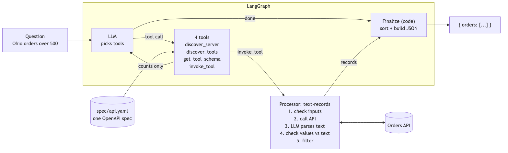

# Raft Order Agent


## Design



- **Agent:** the LLM (`openai/gpt-oss-120b:exacto` via OpenRouter, temperature 0) decides which tool to call next.
- **4 tools, modeled on [Uber's MCP gateway](https://www.uber.com/us/en/blog/designing-mcp-gateway/):** `discover_server` → `discover_tools` → `get_tool_schema` → `invoke_tool`. The agent learns the API by looking it up, not from hard-coded endpoints.
- **One spec as the source of truth, like [Cloudflare's Forge](https://blog.cloudflare.com/forge-open-source-generation-pipeline/):** `spec/api.yaml` is one OpenAPI spec for everything, like Cloudflare's single spec for its whole API. Endpoints are grouped by tag. Each tag is a group the agent finds with `discover_server`, and each endpoint is a tool. The spec also defines the parameters and record fields. Adding an API means adding a tag, its paths and a schema to the spec, not changing code.
- **`invoke_tool`:** looks up the tool in the spec and hands it to the processor the spec names (`x-processor`). The `text-records` processor fetches the raw text, has the LLM parse it, checks every record, then filters, sorts and limits in code, or computes one summary number (count, sum, average, min, max). The LLM gets back only counts. A new kind of API means writing one new processor; after that, it's only spec edits.
- **Finalize:** code builds and sorts the JSON. The LLM never writes the output.

With only two endpoints, hard-coding them would be simpler. The discovery tools are what let this scale to many APIs without changing the agent, which is the problem Uber built the pattern for. The discovery tools are plain lookups, so they return the same answer every time.

## How the LLM is constrained

| The LLM can... | ...limited by |
|---|---|
| Pick tools | Only 4 tools, a cap on loop steps, and only spec-declared parameters |
| Write filters | Only the record fields and a fixed list of operators (`eq ne gt gte lt lte contains in`). Values are type-checked, and `Ohio` becomes `OH` in code |
| Sort, limit, aggregate | Only real fields, `asc`/`desc`, a limit from 1 to 1000, and `count sum avg min max` (math only on number fields). Code does the math |
| Parse records | Strict JSON output. **Every value must appear in the source text**, and there must be exactly one record per input. A record that fails gets one retry with the errors included, then it's rejected and logged, never guessed |
| Write the answer | It can't. Code builds the JSON. If the tools can't answer a request (delete, weather, invalid input), the output is `{"error": "<short reason>"}`, and nothing else the LLM wrote gets through |

Bad arguments go back to the LLM as errors it can fix. Fatal problems, like the API being down or a missing key, stop the run with a clear message and exit code 1.

## Edge cases

- **Context window overflow:** order data never enters the agent's context, only counts. Parsing runs in batches of 20 records or 6,000 characters at most.
- **Model hallucination:** values that aren't in the source text are rejected, and the record counts must match. The output is built by code.
- **API schema changes:** the LLM can parse any text format, and the same checks still apply. If the response key moves, code searches the payload and logs a warning. To try it, run `python tests/changed_api.py`, which serves new layouts with the records under a different key, then `ORDERS_API_URL=http://localhost:5002 python main.py`.
- **API quirks:** the API returns orders in random order, so output is sorted by `orderId`. `/api/order/100` returns order 1001 (the API matches any text in the record), so `get_order` keeps only exact ID matches.


## Extended data

`python main.py --extended` runs the same API with 8 generated orders instead of Raft's 5: one in Raft's format, 4 in messy layouts, and 3 bad ones. Optional fields (`date`, `email`, `payment`) come and go, like real APIs. The bad ones are on purpose: a blank record, one with no total, and a duplicate ID. Without the flag, the API behaves exactly as Raft wrote it.

### Starting the extended API
```
python dummy_customer_api.py --extended
```

### Testing the extended API
```
curl -X GET http://localhost:5001/api/orders
curl -X GET http://localhost:5001/api/order/2001
curl -X GET http://localhost:5001/api/order/2006     # bad record: no total
curl -X GET http://localhost:5001/api/order/9999     # not found (404)
curl -s http://localhost:5001/api/orders | jq '.raw_orders | length'   # 8
```

### Running the agent against it
```
python main.py --extended
```

## Layout

```
main.py                one command: start API, prompt loop, print JSON
logging_config.py      logging setup: console + a new logs/agent_<datetime>.jsonl per run
spec/api.yaml          the one OpenAPI spec: the single source of truth
agents/
  graph.py             LangGraph: agent ⇄ tools → finalize
  tools.py             the 4 tools
  processors.py        what invoke_tool runs for each tool (spec: x-processor)
  records.py           LLM parsing + checks against the source text, and where/fields filtering
  registry.py          loads the spec
  llm.py               OpenRouter client
tests/                 fake LLM + guardrail and end-to-end tests
```
